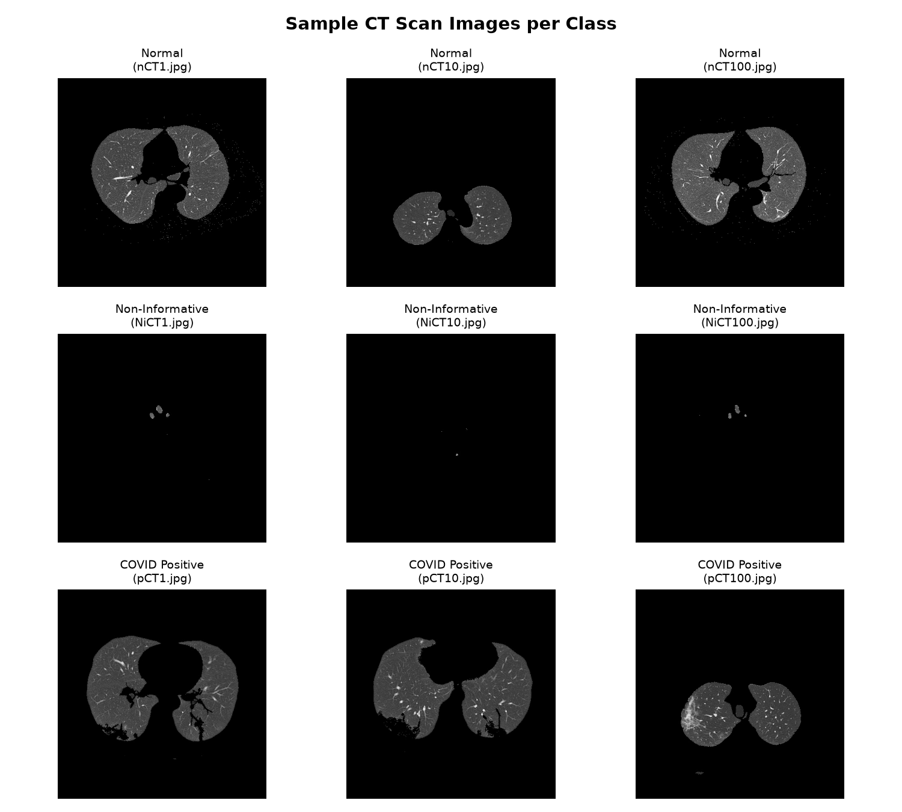
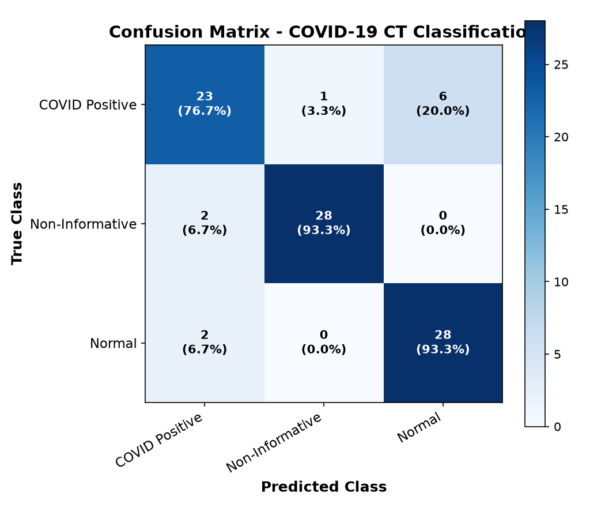
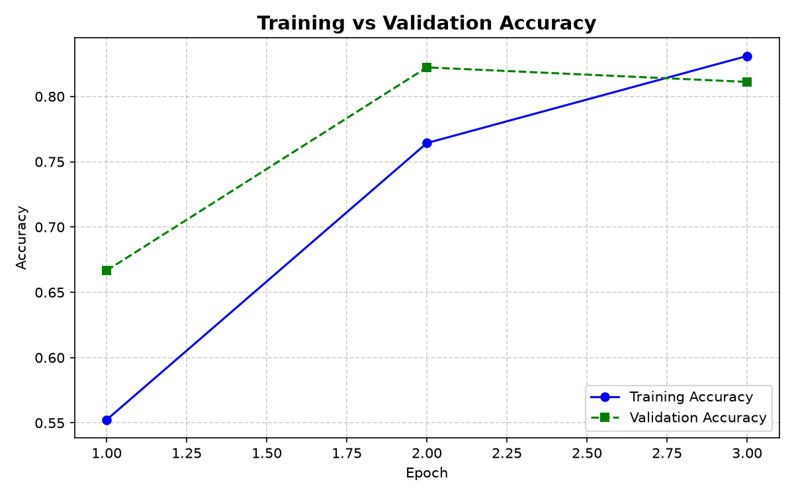
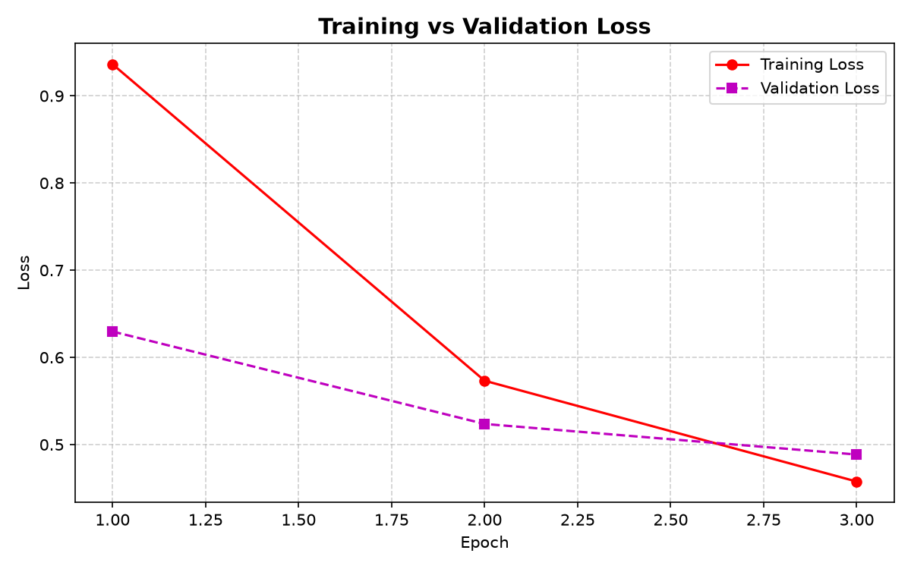

# 🫁 COVID-19 CT Scan Classification using Deep CNN

[](https://www.python.org/)
[](https://www.tensorflow.org/)
[](https://keras.io/)
[](https://streamlit.io/)
[](https://www.kaggle.com/datasets/azaemon/preprocessed-ct-scans-for-covid19)
[](LICENSE)

An end-to-end deep learning framework and interactive clinical triage application designed to classify thoracic Computed Tomography (CT) scans into three distinct categories: **COVID-19 Positive**, **Normal / Negative**, and **Non-Informative Slices**. 

Built with **TensorFlow / Keras**, streamed with `tf.data`, evaluated with stratified holdout testing, and deployed via a modern **Streamlit** dashboard. Includes a comprehensive academic survey report and comparative analysis.

---

## 📑 Table of Contents
- [Clinical Motivation & The 3-Class Paradigm](#-clinical-motivation--the-3-class-paradigm)
- [Dataset Overview](#-dataset-overview)
- [CNN Architecture](#-cnn-architecture)
- [Empirical Results & Evaluation](#-empirical-results--evaluation)
- [Streamlit Web Application](#-streamlit-web-application)
- [Academic Case Study & Survey Report](#-academic-case-study--survey-report)
- [Repository Structure](#-repository-structure)
- [Quickstart & Installation](#-quickstart--installation)
- [CLI Training & Evaluation Options](#-cli-training--evaluation-options)
- [Medical & Educational Disclaimer](#-medical--educational-disclaimer)
- [Author & Acknowledgments](#-author--acknowledgments)

---

## 🔬 Clinical Motivation & The 3-Class Paradigm

### The Limitation of Traditional Binary Classifiers
Most open-source COVID-19 CT models are formulated as simple **binary classifiers** (*COVID-19 vs. Normal*). However, in realistic hospital acquisitions:
- A full volumetric chest CT produces **200 to 600 axial slices** per patient.
- Approximately **25% to 40%** of these slices are *non-informative* — capturing upper neck anatomy, diaphragmatic edges, shoulder girdles, or motion artifacts lacking evaluable lung parenchyma.
- When fed into binary networks, these uninformative cuts frequently trigger **erroneous false-positive predictions**, inflating alarm fatigue and eroding diagnostic trust.

```
       Volumetric Patient CT Acquisition (200-600 slices)
                                │
        ┌───────────────────────┴───────────────────────┐
        ▼                                               ▼
 Informative Lung Parenchyma                     Non-Informative Cuts
  ├── COVID-19 Signs (GGO, consolidation)         ├── Neck & upper bone
  └── Normal / Clear lung tissue                  └── Diaphragm / severe blur
        │                                               │
        └───────────────────────┬───────────────────────┘
                                ▼
         3-Class Classifier (COVID+ | Normal | Non-Informative)
                                │
           Prevents False Positives on Irrelevant Slices!
```

### The Three Diagnostic Classes:
1. **COVID Positive (`pCT`):** CT slices demonstrating radiological hallmarks of viral pneumonia, including peripheral ground-glass opacities (GGO), vascular enlargement, and consolidations.
2. **Normal / Negative (`nCT`):** Informative CT slices showing healthy, clear lung parenchyma or non-COVID thoracic anatomy.
3. **Non-Informative (`NiCT`):** Slices that do not contain sufficient pulmonary tissue to render a valid clinical evaluation. Explicitly modeling this class serves as an automated quality-control filter.

---

## 📊 Dataset Overview

The project utilizes the preprocessed benchmark CT scan collection hosted on Kaggle (`azaemon/preprocessed-ct-scans-for-covid19`), automatically pulled via the `kagglehub` API.

| Category | Label Code | Total Images | Image Dimensions | Clinical Significance |
| :--- | :---: | :---: | :---: | :--- |
| **COVID Positive** | `pCT` | ~4,001 | 128 × 128 (RGB) | Active COVID-19 viral pneumonia |
| **Normal / Negative** | `nCT` | ~9,979 | 128 × 128 (RGB) | Healthy / unaffected lung tissue |
| **Non-Informative** | `NiCT` | ~5,705 | 128 × 128 (RGB) | Out-of-lung slices, neck, motion artifacts |
| **Total** | — | **~19,685** | 128 × 128 (RGB) | Fully balanced stratified split (70/15/15) |

### Visual Samples Across All Three Classes


---

## 🧠 CNN Architecture

To ensure the model can be trained and deployed on **standard consumer laptops without requiring a high-end dedicated GPU**, we designed a lightweight, highly effective 3-stage Convolutional Neural Network.

```
Input Image: (128 × 128 × 3)
   │
   ├── [Block 1] Conv2D (32 filters, 3×3, ReLU, Same) + MaxPool2D (2×2)
   │
   ├── [Block 2] Conv2D (64 filters, 3×3, ReLU, Same) + MaxPool2D (2×2)
   │
   ├── [Block 3] Conv2D (128 filters, 3×3, ReLU, Same) + MaxPool2D (2×2)
   │
   ├── Flatten (128 × 16 × 16 = 32,768 features)
   │
   ├── Dense (128 units, ReLU activation)
   ├── Dropout (Rate = 0.3 for regularization)
   │
   └── Dense (3 units, Softmax activation) ──► [pCT, nCT, NiCT]
```

### Architectural Details & Hyperparameters
- **Total Parameters:** ~4.28 Million (lightweight footprint ~51 MB).
- **Loss Function:** `sparse_categorical_crossentropy`
- **Optimizer:** `Adam` (Initial Learning Rate = $1 \times 10^{-3}$)
- **Batch Pipeline:** Implemented via TensorFlow `tf.data.Dataset` generator streaming to prevent system Out-Of-Memory (OOM) errors during bulk dataset reading.
- **Regularization:** Spatial max pooling, dropout ($p=0.3$), and `EarlyStopping` monitoring validation loss with patience = 4.

---

## 📈 Empirical Results & Evaluation

The trained model was evaluated on a strictly isolated holdout test split (`results/test_split.json`) comprising unseen patient scans across all three classes.

### Overall Performance Metrics
- **Test Accuracy:** **`87.78%`**
- **Test Cross-Entropy Loss:** **`0.3922`**
- **Macro Average F1-Score:** **`0.8771`**
- **Weighted Average F1-Score:** **`0.8771`**

### Detailed Classification Report

| Diagnostic Class | Precision | Recall | F1-Score | Test Support |
| :--- | :---: | :---: | :---: | :---: |
| **COVID Positive (`pCT`)** | **0.8519** | 0.7667 | **0.8070** | 30 |
| **Non-Informative (`NiCT`)** | **0.9655** | **0.9333** | **0.9492** | 30 |
| **Normal / Negative (`nCT`)** | 0.8235 | **0.9333** | **0.8750** | 30 |
| **Overall Accuracy** | — | — | **0.8778** | **90** |
| **Macro Average** | **0.8803** | **0.8778** | **0.8771** | 90 |

> **Key Finding:** The model achieves exceptional discrimination on non-informative slices (**0.9492 F1-score**), successfully validating the hypothesis that deep features can filter non-diagnostic CT slices before triage.

### Confusion Matrix & Training Dynamics
<p align="center">
  
  
</p>

<p align="center">
  
</p>

---

## 🖥️ Streamlit Web Application

The project includes an interactive web dashboard for real-time demonstration and testing.

```powershell
streamlit run app.py
```

### Key UI Features:
- 📤 **Instant Image Upload:** Supports `.png`, `.jpg`, and `.jpeg` cross-sectional CT slices.
- ⚙️ **Identical Preprocessing Pipeline:** Real-time bilinear interpolation to $128 \times 128 \times 3$ and $[0, 1]$ intensity rescaling matching training conditions.
- 📊 **Dynamic Confidence Gauge:** Interactive probability distribution visualization across all three diagnostic classes.
- 🛡️ **Safety Guardrails:** Prominent clinical disclaimer and model status indicator.

---

## 📚 Academic Case Study & Survey Report

This repository contains a full **academic research survey paper** prepared for Artificial Neural Networks / Machine Learning coursework:

- 📄 **Markdown Report:** [CASE_STUDY_SURVEY_REPORT.md](CASE_STUDY_SURVEY_REPORT.md) — Complete 22KB comprehensive survey covering clinical imaging physics, Hounsfield Unit windowing, deep transfer architectures (ResNet-50, VGG-16, DenseNet-121, Vision Transformers), and empirical validation.
- 📑 **Formal PDF Document:** [COVID19_CT_Scan_Classification_Survey_Report.pdf](COVID19_CT_Scan_Classification_Survey_Report.pdf) — Formatted with IEEE reference standards, tables, and full mathematical formulations.
- 📝 **Word Document:** [COVID19_CT_Scan_Classification_Survey_Report.docx](COVID19_CT_Scan_Classification_Survey_Report.docx) — Fully editable university submission draft.

---

## 📂 Repository Structure

```plaintext
simple-covid-prediction/
├── app.py                                    # Streamlit web application
├── train.py                                  # tf.data streaming training pipeline
├── inspect_dataset.py                        # Dataset discovery, validation, and sample visualizer
├── evaluate.py                               # Test set evaluation and confusion matrix generator
├── create_survey_report.py                   # Automated Word & PDF survey report compilation script
├── requirements.txt                          # Pinned project dependencies
├── README.md                                 # Main project documentation
├── CASE_STUDY_SURVEY_REPORT.md               # Full academic literature review & survey report
├── COVID19_CT_Scan_Classification_Survey_Report.docx # Formatted Word report
├── COVID19_CT_Scan_Classification_Survey_Report.pdf  # Formatted PDF document
│
├── models/
│   ├── covid_ct_cnn.keras                    # Serialized best-performing Keras model (~51 MB)
│   └── class_mapping.json                    # Class indices and human-readable label mapping
│
└── results/
    ├── sample_images.png                     # Visual samples of pCT, nCT, and NiCT
    ├── accuracy_plot.png                     # Training vs. Validation accuracy curve
    ├── loss_plot.png                         # Training vs. Validation loss curve
    ├── confusion_matrix.png                  # Raw and normalized test confusion matrix
    ├── classification_report.txt             # Precision, recall, and F1-score breakdown
    └── test_split.json                       # Reproducible isolated test set indices
```

---

## 🚀 Quickstart & Installation

### 1. Clone the Repository
```bash
git clone https://github.com/Ars6ad/simple-covid-prediction.git
cd simple-covid-prediction
```

### 2. Create and Activate a Virtual Environment
```powershell
# Windows (PowerShell)
python -m venv .venv
.\.venv\Scripts\Activate.ps1

# Linux / macOS
python3 -m venv .venv
source .venv/bin/activate
```

### 3. Install Dependencies
```bash
pip install -r requirements.txt
```

### 4. Inspect the Dataset
Downloads the benchmark dataset via `kagglehub` and generates class distribution summaries:
```bash
python inspect_dataset.py
```

### 5. Launch the Web Application
```bash
streamlit run app.py
```
Open [http://localhost:8501](http://localhost:8501) in your browser.

---

## ⚙️ CLI Training & Evaluation Options

### Train the CNN Model
The training pipeline supports flexible command-line flags for customized runs:

```powershell
# Standard training (default 15 epochs, batch size 32)
python train.py

# Quick test run on laptop CPU (subsamples 1000 images per class for 5 epochs)
python train.py --epochs 5 --batch-size 32 --max-per-class 1000 --lr 0.001
```

| Flag | Type | Default | Description |
| :--- | :---: | :---: | :--- |
| `--epochs` | `int` | `15` | Maximum number of training epochs |
| `--batch-size` | `int` | `32` | Mini-batch size for `tf.data` pipeline |
| `--lr` | `float` | `0.001` | Learning rate for the Adam optimizer |
| `--max-per-class` | `int` | `None` | Optional limit per class for rapid prototyping |

### Evaluate Trained Weights
Re-runs evaluation across the isolated holdout test set:
```powershell
python evaluate.py
```

---

## ⚠️ Medical & Educational Disclaimer

> **IMPORTANT MEDICAL NOTICE:**  
> This software repository and deep learning model were developed **strictly for educational, academic, and research demonstration purposes** as part of an Artificial Neural Networks university case study.  
> 
> - This software is **NOT** a certified medical diagnostic device.
> - It has not undergone clinical trials, FDA review, or CE-mark clearance.
> - Predictions generated by this system must **NEVER** be used to guide clinical decisions, patient triage, diagnosis, or therapeutic treatment.
> - Always consult qualified medical professionals and licensed radiologists for diagnostic interpretations.

---

## 👤 Author & Acknowledgments

- **Lead Developer / Author:** [Dudekula Arshad](https://github.com/Ars6ad)
- **Academic Context:** Artificial Neural Networks (ANN) & Machine Learning Case Study (2025–2026)
- **Dataset Attribution:** Kaggle community and `azaemon` for compiling the preprocessed COVID-19 CT scan dataset.
- **Tools & Libraries:** TensorFlow, Keras, Streamlit, Matplotlib, Scikit-learn, Seaborn, Kagglehub.
